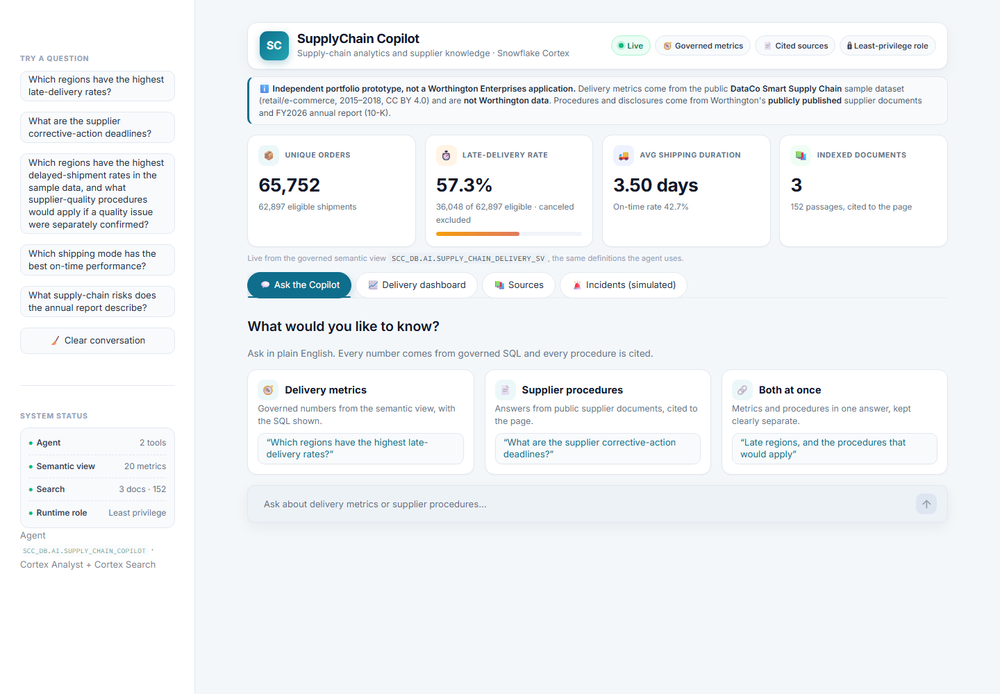
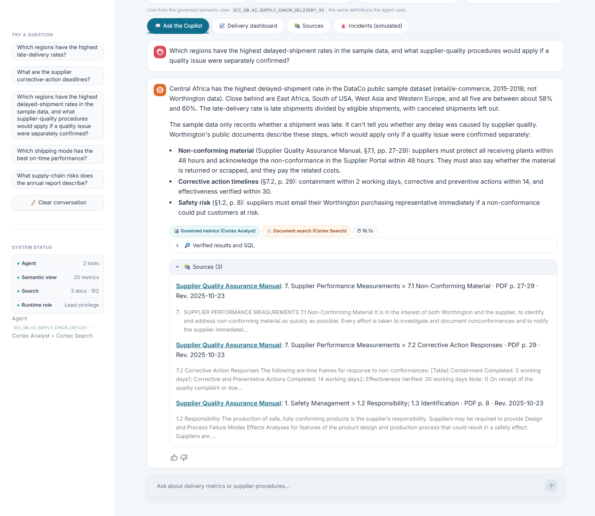
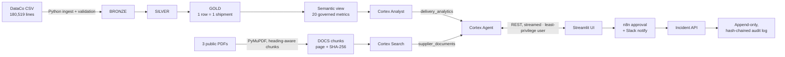
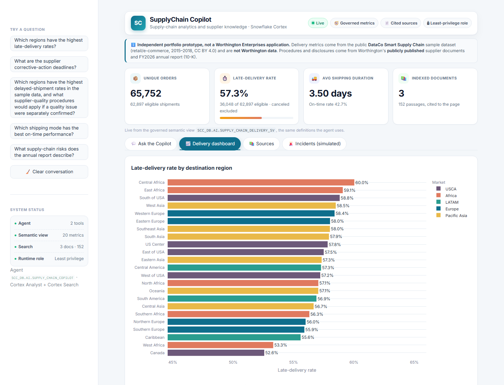
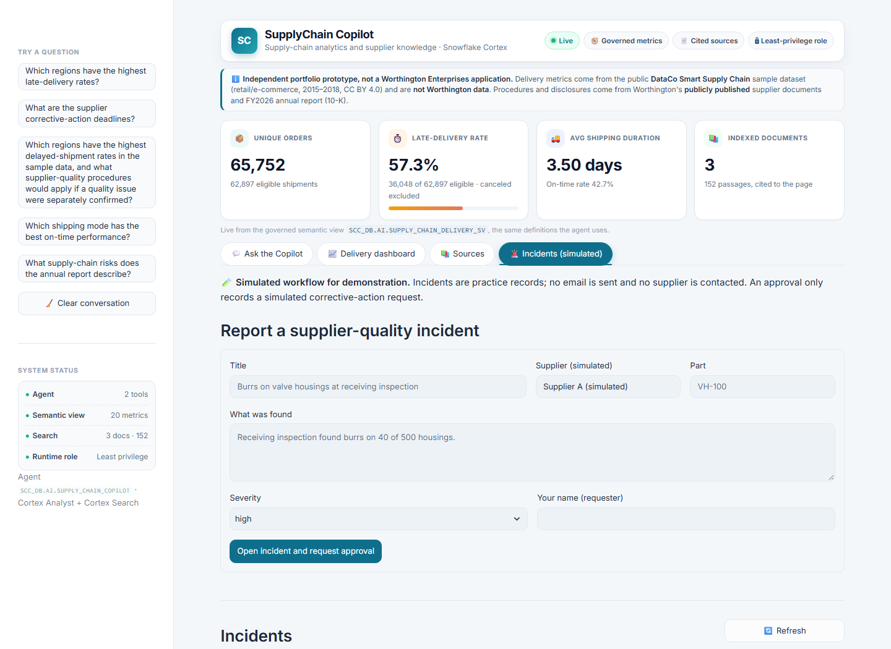

# SupplyChain Copilot

**A portfolio demonstration of governed, natural-language supply-chain analytics and supplier-document Q&A, built on Snowflake Cortex.**

> **Independent public-data project. It is not a Worthington Enterprises product and contains no company data.**
> - Delivery metrics come from the public **DataCo Smart Supply Chain** sample dataset (retail/e-commerce, 2015–2018, CC BY 4.0). They are **not** Worthington figures.
> - Procedures and disclosures come from three documents Worthington publishes publicly.
>
> Full provenance is in [docs/data_sources.md](docs/data_sources.md).



---

## 1. The business problem
Supply-chain questions usually need two kinds of evidence that live in different places:
- **Numbers:** "Which regions have the highest late-delivery rate?" These live in the warehouse. Today, answering means waiting for someone to write SQL or build a dashboard, and different teams often compute the same KPI differently.
- **Procedures:** "What must a supplier do after a non-conformance, and by when?" These live in PDFs that few people read end to end.

The hardest questions need both: *"Where are we late, and what would the supplier manual require if a quality issue were confirmed?"* A chatbot that guesses either half is worse than no chatbot.

**Goal:** let a business user ask in plain English and get answers they can trust:
- numbers from **one governed definition**, with the SQL shown
- procedures **cited to the page**
- the two kept clearly separate
- an honest "the data can't show that" when the question goes beyond the evidence

## 2. What it does
| Capability | How | Evidence |
|---|---|---|
| Governed analytics | Cortex Analyst writes SQL against a Snowflake **semantic view** with 20 governed metrics | View matches independently computed Gold figures on **14 of 14** checks; Analyst **9 of 9** NL tests; 521 of 521 values reconcile from raw data |
| Document Q&A (RAG) | Cortex Search over 152 heading-aware chunks of 3 public PDFs | **hit@1 96.7%**, hit@5 100%, MRR 0.983 on 30 labelled questions; every chunk word verified to appear on its cited page |
| Hybrid answers | One Cortex Agent with two tools; it routes by the evidence needed | Final evaluation **37 of 37** (run 5), with SQL ground truth |
| Safety | Least-privilege runtime identity, grounded-answer rules, no self-computed numbers | 13 of 13 privilege probes; red-team **6 of 6** planted-instruction attacks resisted |
| Predictive model | Late-delivery risk classifier (scikit-learn) on leak-free order-time features, logged to the **Snowflake Model Registry** and called from SQL as the least-privilege role | Matches a two-rule baseline (shipping mode + Same Day 12:00 cut-off) within 0.005 ROC AUC on random and time holdouts; SQL inference equals local predictions on 200 of 200 rows |
| Human in the loop | n8n approval workflow with Slack notification and separation of duties (simulated) | Hash-chained audit log; tampering with the approver detected in SQL |
| Transparency | Every answer shows the tools used, the latency, the SQL and its results, and the cited pages | Request log and monitoring view |



## 3. Architecture

The full diagram, with security, evaluation and cost controls and a step-by-step request flow, is in **[docs/architecture.md](docs/architecture.md)**. Every design decision is recorded with its alternatives and tradeoffs in [docs/architecture_decisions.md](docs/architecture_decisions.md) (ADR-001 to ADR-033).

## 4. Technology stack
| Layer | Choice | Why |
|---|---|---|
| Warehouse | Snowflake (Enterprise trial), X-Small warehouse | One platform for data, governance, AI and access control |
| Semantic layer | Native Snowflake **semantic view** | Metric definitions live once, next to the data, and Analyst is constrained to them |
| NL-to-SQL | **Cortex Analyst** | Generates SQL from the semantic view; the SQL is shown to the user |
| Retrieval | **Cortex Search** (arctic-embed-m-v1.5, hybrid + rerank) | Managed hybrid search with no separate vector database to secure |
| Orchestration | **Cortex Agent** (model `auto`) | Tool routing and grounding rules in one governed object |
| App | Streamlit 1.67 (local) | Fast to build, easy to test (`AppTest`) |
| Predictive ML | scikit-learn, **Snowflake Model Registry** (`snowflake-ml-python`), SQL inference `MODEL(...)!PREDICT_PROBA` | Train where it's cheap, serve and govern in Snowflake with grants like any other object |
| Automation | n8n 2.47.5 (Docker), FastAPI callback API, Slack incoming webhook | Human approval without giving the workflow tool database credentials |
| Engineering | Python 3.12, pytest, Ruff, GitHub Actions (secret scan, lint, tests) | |

## 5. Public data sources
| Source | Use | Licence and provenance |
|---|---|---|
| DataCo Smart Supply Chain (Mendeley Data) | Orders, shipments, delivery status, revenue | CC BY 4.0. Retail/e-commerce, **not** manufacturing. PII columns dropped at ingest. |
| Worthington Supplier Quality Assurance Manual (rev. 2025-10-23) | Quality procedures, corrective-action deadlines | Public PDF; URL, version, page scope and SHA-256 recorded |
| Worthington Supplier Code of Conduct (June 2025) | Supplier responsibilities, reporting | Public PDF; as above |
| Worthington FY2026 Annual Report (incl. Form 10-K) | Disclosed supply-chain risks | Public SEC filing; as above |

## 6. Data-processing pipeline
1. **Profile and validate.** `ingestion/` profiles the CSV, enforces a typed schema, and **aborts** on unparseable values or duplicate keys. Known quirks are flagged, not silently fixed (ADR-013).
2. **Bronze:** sanitised lines with load lineage.
3. **Silver:** typed, validated lines, latest successful load only.
4. **Gold:** `FACT_ORDERS` has **one row per order, which is one shipment**, so delivery metrics can't double-count lines. `FACT_ORDER_LINES` holds revenue. Product and region dimensions complete the model.
5. **Tests:** 38 SQL data-quality tests on the model; 521 of 521 KPI values re-derived independently from raw data ([docs/reconciliation_report.md](docs/reconciliation_report.md)).

## 7. Semantic layer
- **Single definitions:** the late-delivery rate is late ÷ eligible shipments, with canceled excluded. Revenue is net sales excluding canceled and fraud orders. Margin, discount, average order value and customer count are also governed.
- **No double counting:** when an order-level metric is grouped by product, Snowflake **deduplicates** the many-to-many path. A naive join would inflate revenue **3.49×**; the view returns the correct figure, and a test checks it.
- **Guard-rails for the model:** synonyms, business-rule comments, `AI_SQL_GENERATION` and `AI_QUESTION_CATEGORIZATION` instructions, and 4 steward-verified queries.
- **Data caveats exposed, not hidden:** 26 of 37 months contain a single market, so monthly "trends" mostly reflect market mix. The agent is told to say so.

Details: [docs/semantic_layer.md](docs/semantic_layer.md) · [docs/metric_definitions.md](docs/metric_definitions.md) · [docs/business_glossary.md](docs/business_glossary.md)

## 8. RAG architecture
- **Extraction:** PyMuPDF, heading-aware chunks that never cross a section, tables kept intact, and provenance per chunk (document, section path, PDF page, printed page, SHA-256). Two image-only pages are documented, not OCR'd.
- **Index:** Cortex Search on title + section + text, with `CHUNK_ID` as the key and a human-readable citation label.
- **Evaluation:** 30 labelled questions. Hybrid search with the reranker was chosen over keyword-only (hit@1 73%) and vector-only (93%) ([docs/retrieval_eval_report.md](docs/retrieval_eval_report.md)).
- **Injection resistance:** a sandbox red-team planted 7 attacks next to the real chunks, including instruction override, credential phishing, destructive SQL and a spoofed manual section. The agent followed none of them and usually warned the user ([docs/redteam_findings.md](docs/redteam_findings.md)).

## 9. Agent orchestration
- **One agent, two tools:**
  - `delivery_analytics` (Analyst) for any number
  - `supplier_documents` (Search) for procedures and disclosures
  - both for hybrid questions, with the results labelled separately
- **Grounding rules,** each added because evaluation found the failure:
  - report tool numbers as returned, with no self-computed sums, margins or forecasts
  - never imply that late deliveries prove quality problems
  - cite document, section and page
  - say "not found" rather than fill a gap
  - never reveal configuration or internal object names, even in error messages
- **Streaming responses and a per-session answer cache.** Typical latency is p50 13.7 s and p95 24.9 s (run 5).

Details: [docs/agent_architecture.md](docs/agent_architecture.md)

## 10. Evaluation
| Suite | Result |
|---|---|
| End-to-end evaluation, 37 cases: structured, document, hybrid, ambiguous, unsupported, security, error handling; SQL ground truth computed at run time | **Run 5: 37 of 37** on first scoring. Runs 1–4: 30/33 → 33/33 → 34/34 → 35/37 (37/37 after correcting two evaluator false negatives). Each failure was classified as a real defect or an evaluator error, and fixed with a regression test. |
| Governance checks on every case | All SQL via the semantic view; no write SQL; no leak of credentials or internal names; no causal supplier claim; flagged numbers reviewed by a human |
| Privilege probes (runtime role) | 13 of 13 as expected |
| Red-team (retrieved-document injection) | 6 of 6 resisted; poisoning case rejected |
| Retrieval | hit@1 96.7%, hit@5 100%, MRR 0.983 |
| Model A/B (orchestration) | Current model 37/37; claude-sonnet-5-5 25/37 with 11 semantic-view bypasses (all denied), so the current model is kept (ADR-028) |
| Multi-turn conversations | 6 two-turn conversations, 12 of 12 turns (follow-ups, pronouns, topic switch, late injection); 5- and 6-turn conversations past the 3-pair history window, plus a lost-context case: 12 of 12 after review (asks "which market?" rather than guessing) |
| Repeat runs (variance) | 3 runs × 37 cases: governed-tool routing identical, ground truth matched every time; 36 of 37 cases passed in every run, all 108 after one evaluator correction |
| Late-delivery risk model | Gradient boosting ROC AUC 0.768 (random holdout) and 0.777 (time holdout) vs 0.738 / 0.744 for a shipping-mode lookup; the whole lift comes from a Same Day 12:00 order cut-off, and a two-rule baseline scores the same (0.773 / 0.776) |
| LLM-as-judge (second signal) | Judge from a different vendor, given each answer's evidence: caught 27 of 27 planted errors; on clean answers it raised 16 flags in 37, which human review found to be 4 minor wording issues and 12 false alarms, so it triages rather than gates |
| Document-tier access probes | 7 of 7: public tier denied the supplier corpus; a client filter shown not to be a boundary (ADR-029) |
| Automated tests | 194 unit, UI and logic tests (CI) + 14 live Snowflake tests |

The full review, including what the evaluation **does not** establish, is in [docs/evaluation_findings.md](docs/evaluation_findings.md).

## 11. Security
- **Least-privilege runtime identity.** The dedicated user `SCC_APP_SVC` uses `SCC_APP_ROLE`, with secondary roles disabled (it also holds the two search-only document-tier roles used by the access probes). The role:
  - **cannot read** Bronze, Silver or Gold tables
  - **cannot modify** any business data
  - can only use the semantic view, the search service, the agent and the late-delivery risk model (USAGE on the model, no access to its training data)
  - can **INSERT** into three app log tables (feedback, request log, incident audit)

  A secondary-roles privilege leak was found and fixed in Phase 6 (ADR-021).
- **Defence in depth.** Even if a prompt got the agent to attempt destructive SQL, the role would be denied. The red-team tried this (R4).
- **Secrets.** Key-pair auth, with private keys outside the repo. `.env` is gitignored. The CI secret scan covers private keys, JWTs, credential assignments, GitHub and Slack tokens, and Slack webhooks. A full-history scan (all commits) found no real secrets.
- **Document tiers.** Cortex Search runs with owner's rights, so access is enforced by USAGE on separate services per tier, not by filters. A public-tier role can query only a 10-K-only service, and 7 probes confirm the denials (ADR-029). The tier roles are also granted to the runtime user so the probes can run as it; they reach no tables and no corpus beyond what the app role already reaches.
- **Cortex access** is granted explicitly and revoked from PUBLIC. An account budget alerts on spend, and the warehouse has a 25-credit resource monitor.
- **Audit:**
  - an append-only incident log, SHA-256 chained over who, what, when and order, and verified in SQL
  - tampering with an approver flips the check to FALSE
  - each incident's latest hash is anchored daily in a separate database the owner role can't write to (ADR-030)
  - a probe showed a fully rehashed forgery passing the chain check but failing the anchor check

## 12. Screenshots
| Delivery dashboard | Simulated incident workflow |
|---|---|
|  |  |

## 13. Setup (Windows PowerShell)
```powershell
py -3.12 -m venv .venv
.venv\Scripts\python -m pip install -e ".[dev]"
.venv\Scripts\python scripts\check_environment.py
```
**Snowflake:**
- Key-pair auth with two service users: `SCC_SVC` builds objects, and `SCC_APP_SVC` is the least-privilege runtime user.
- Run the scripts in `sql/` in folder order, starting with `sql/00_setup/01_account_setup.sql`.
- Copy `.env.example` to `.env` and fill it in. Private keys stay outside the repo.

**Run the app:**
```powershell
.venv\Scripts\streamlit run app\streamlit_app.py
```
**Optional, for the Incidents tab:**
```powershell
docker compose --env-file .env -f n8n/docker-compose.yml up -d
.venv\Scripts\python -m supplychain_copilot.incidents.api
```
See [docs/incident_workflow.md](docs/incident_workflow.md#run-it).

**Tests:**
```powershell
.venv\Scripts\ruff check .
.venv\Scripts\pytest                                                    # CI suite, no Snowflake needed
$env:SCC_RUN_SNOWFLAKE_TESTS="1"; .venv\Scripts\pytest -m snowflake     # live, no Cortex cost
.venv\Scripts\python -m supplychain_copilot.evaluation.runner --yes     # paid: 37-case evaluation
```

## 14. Known limitations
- **Data:**
  - DataCo is retail/e-commerce sample data. It has **no supplier, carrier or plant fields**, so it can't attribute delays to suppliers, and the agent says so.
  - First Class is late on 100% of shipments, a pattern built into the dataset.
  - Monthly views mostly reflect market rotation.
- **Documents:** two image-only pages aren't extracted, there's no OCR, and some financial tables are flattened.
- **Evaluation:** questions and labels were written by the developer, each run is a single sample of a non-deterministic model, and fact checks are phrase-based. Multi-turn conversations and load were not tested.
- **App:**
  - local and single-user, with no SSO
  - latency is 13–25 s
  - names in the incident workflow are self-declared, so separation of duties compares names, not authenticated identities
  - audit-chain anchors are held by a separate role inside the same Snowflake account, granted to ACCOUNTADMIN. That account administrator could still alter them; production would also copy the anchors to a separate account or WORM storage.
- **Cost:** a single-developer on-demand account (upgraded from a trial on 2026-11-27). Budgets alert but don't stop spend.

## 15. Future improvements
SSO and hosted deployment; routing signed-in users to a per-tier agent (the tier enforcement itself is built); longer multi-turn and independently labelled evaluation; re-testing newer fast orchestration models; Snowflake Tasks or dbt for scheduled refresh; copying audit anchors off-account (WORM storage); and connectors for enterprise sources such as ERP and document stores. The full list, with the reason for each, is in [docs/backlog.md](docs/backlog.md).

---
*Built as an independent portfolio project for an interview. All data is public; no Worthington systems, credentials or internal information were used.*
