# Architecture

> Independent portfolio project using **public data only**: the DataCo sample dataset and Worthington's publicly published PDFs. It is not a Worthington Enterprises system.

## System diagram

```mermaid
flowchart LR
    %% ---------- sources ----------
    subgraph SRC["Public sources"]
        CSV["DataCo Smart Supply Chain CSV<br/>(CC BY 4.0, 180,519 order lines)"]
        PDF["3 public PDFs<br/>Supplier Quality Manual · Code of Conduct · FY2026 10-K"]
    end

    %% ---------- structured path ----------
    subgraph WH["Snowflake · SCC_DB"]
        direction TB
        BR["BRONZE<br/>sanitised raw lines + lineage<br/>(PII columns dropped)"]
        SI["SILVER<br/>typed, validated order lines"]
        GO["GOLD<br/>FACT_ORDERS (1 row = 1 shipment)<br/>FACT_ORDER_LINES · DIM_PRODUCTS · DIM_REGIONS<br/>V_KPI_* views"]
        SV["Semantic view SUPPLY_CHAIN_DELIVERY_SV<br/>20 governed metrics · 24 dimensions<br/>4 verified queries"]
        DC["DOCS.DOCUMENT_CHUNKS<br/>152 heading-aware chunks<br/>page + SHA-256 provenance"]
        CS["Cortex Search<br/>SUPPLIER_DOCS_SEARCH<br/>hybrid vector + keyword"]
        LOG["APP logs (insert-only)<br/>AGENT_REQUEST_LOG · AGENT_FEEDBACK<br/>INCIDENT_AUDIT_LOG (SHA-256 chain)"]
        BR --> SI --> GO --> SV
        DC --> CS
    end

    CSV -->|"Python ingest<br/>profiling + validation"| BR
    PDF -->|"PyMuPDF extraction<br/>heading-aware chunking"| DC

    %% ---------- AI ----------
    subgraph AI["Snowflake Cortex"]
        AN["Cortex Analyst<br/>NL → SQL on the semantic view"]
        AG["Cortex Agent SUPPLY_CHAIN_COPILOT<br/>routes: metrics · documents · both<br/>no own arithmetic, cite or decline"]
    end
    SV --> AN
    AN -->|"tool: delivery_analytics"| AG
    CS -->|"tool: supplier_documents"| AG

    %% ---------- app ----------
    subgraph APP["Local application"]
        UI["Streamlit UI<br/>KPIs · chat · SQL view · citations<br/>charts · feedback · incidents"]
        API["Incident API (FastAPI, 127.0.0.1)<br/>state machine · separation of duties"]
        N8N["n8n 2.47.5 (Docker, 127.0.0.1)<br/>human approval form · 24 h timeout"]
        SL["Slack channel<br/>approval notifications"]
    end
    AG <-->|"REST, streamed<br/>as SCC_APP_SVC"| UI
    UI -->|"open · draft · submit"| N8N
    N8N -->|"token-authenticated callbacks"| API
    N8N -.->|"incoming webhook"| SL
    API --> LOG
    UI --> LOG

    %% ---------- controls ----------
    subgraph CTRL["Controls and evaluation"]
        SEC["Least privilege: SCC_APP_ROLE<br/>no raw-table reads · no business-data writes<br/>secondary roles off · Cortex revoked from PUBLIC"]
        EV["Evaluation: 37 cases with SQL ground truth<br/>retrieval set (hit@1 96.7%) · 7-attack red-team<br/>SQL data-quality suites · CI secret scan"]
        CO["Cost: X-Small warehouse, 60 s auto-suspend<br/>25-credit resource monitor · account budget alert"]
    end
    SEC -.-> AG
    EV -.-> AG
    CO -.-> WH
```

## How a question flows

1. **The user asks** in Streamlit. The app calls the Cortex Agent over REST as the dedicated runtime user `SCC_APP_SVC`, which uses only `SCC_APP_ROLE` with secondary roles disabled (its two search-only document-tier roles are used only by the access probes, ADR-029). The response streams back.
2. **The agent routes** by the kind of evidence needed:
   - numbers go to **`delivery_analytics`** (Cortex Analyst, which writes SQL against the semantic view)
   - procedures and disclosures go to **`supplier_documents`** (Cortex Search)
   - hybrid questions call both and keep the two kinds of result labelled separately
3. **Numbers stay governed.** Analyst may only use the semantic view's metric definitions. The runtime role can't read the Gold tables, so SQL that bypassed the definitions would be *denied*, not silently answered. That happened once in evaluation (U4); the fix and the check are in `docs/evaluation_findings.md`.
4. **Answers are grounded:**
   - figures come back with the SQL that produced them
   - procedures come back with document, section and PDF page
   - the agent is told not to compute its own totals or margins, not to forecast, and not to claim that delays prove quality problems
5. **Everything is logged:** request id, tools, latency, tokens and the eval outcome, with no answer text and no secrets. The monitoring view summarises it daily.
6. **Actions need a human** (simulated). An incident drafted by the Copilot waits in n8n for an approver who is not the requester. Every step is appended to a hash-chained log, and the chain is checked in SQL.

## Data layers

| Layer | Object | Grain | Key rule |
|---|---|---|---|
| Bronze | `BRONZE.DATACO_ORDER_LINES` | source line | Sanitised: customer name, email, password, street and zip code dropped at ingest; lineage per load. 180,519 lines. |
| Silver | `SILVER.ORDER_LINES` | order line | Typed and validated; key uniqueness checked (no duplicates found, 180,519 lines); latest successful load only |
| Gold | `FACT_ORDERS` | order = shipment | Delivery metrics computed here, so lines are never double-counted |
| Gold | `FACT_ORDER_LINES` | order line | Revenue, units and profit |
| Semantic | `AI.SUPPLY_CHAIN_DELIVERY_SV` | logical model | One definition per metric; many-to-many paths are deduplicated, not inflated (a naive join inflates revenue 3.49×) |

## Where each design decision is recorded
`docs/architecture_decisions.md` holds ADR-001 to ADR-027, each with why, the alternatives and the tradeoffs. Start with:
- ADR-010: SQL over a semantic view, not embeddings, for metrics
- ADR-020: one agent with two tools
- ADR-021: a dedicated least-privilege runtime user
- ADR-024: evaluation method
- ADR-026: the red-team
- ADR-027: human approval in n8n
